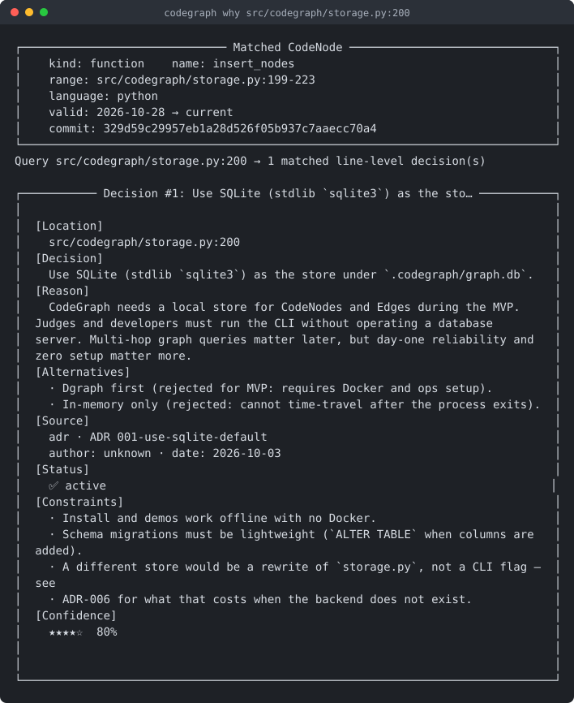
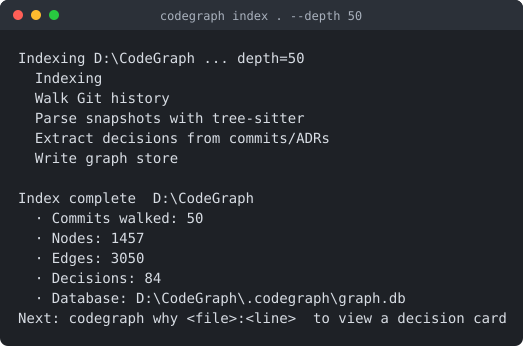
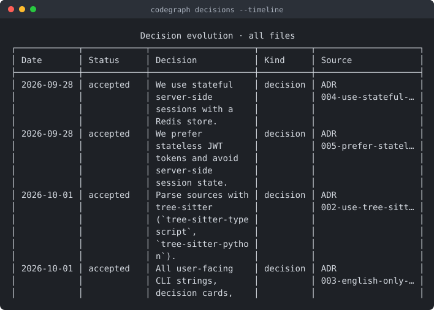
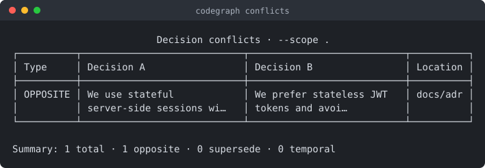

# CodeGraph


**English:** Turn code structure, git history, and design decisions into one queryable graph — ask “why is this line here?” and get a decision card, not just a blame line.

Why not just ask an AI? Because AI cannot read a closed issue from two years ago — and because a commit subject is not an answer. CodeGraph shows a decision card only when the record states a reason or a rejected alternative; everything else is kept as history you can ask for explicitly. On Express.js that means **22 decisions out of 242 records**, not 174 "decisions" that were mostly version bumps.

**中文：** 把代码结构、历史变更和设计决策变成一张可查询的图。不只回答「谁改的」，更回答「为什么这么写」。

**Status:** alpha · 8 CLI commands · 7 languages · SQLite storage · 221 tests

See [docs/architecture.md](docs/architecture.md) for the full architecture overview.

- GitHub: https://github.com/fourwich/codegraph
- Live demo: https://fourwich.github.io/codegraph

### What it looks like

`codegraph why` on a line of this repository — the card is the ADR that decided
the line, reached from the line itself:



`codegraph index` builds the graph; the counts below are real output from this
repository:



`codegraph decisions --timeline` lists decisions oldest first, and
`codegraph conflicts` reports contradictions it can justify:

<p>
  
  
</p>

These are not mockups: `scripts/render_terminal_svg.py` renders text captured
from an actual run, so a screenshot cannot drift from the tool.

See [benchmarks](docs/benchmarks.md) for real-project attempts and synthetic performance numbers.
See [case study on Express.js](docs/case-study.md) for real-world results after JavaScript support.
See [decision extraction](docs/extraction-recall.md) for how `decision` and `event` records are separated, and how to reproduce the precision numbers.

### Reviewing this in five minutes

```bash
pip install -e ".[dev]"     # or: uv pip install -e ".[dev]"
pytest -q                   # 221 tests, no network needed
codegraph index .           # builds the graph for this repository
codegraph why src/codegraph/storage.py:200    # one decision card, end to end
codegraph graph --at 2026-09-28 --scope src   # the same repository in the past
```

Then: [the architecture](docs/architecture.md) ·
[what was measured and what is still a limitation](docs/extraction-recall.md) ·
[the JSON contract for editors](docs/json-contract.md) ·
[the 5-minute pitch script](docs/pitch_5min.md).

## Status

Verified with `pytest -q` and `codegraph --help` (221 tests passing, over 80% coverage).

Every test count in this README and in `docs/` is checked against `pytest --collect-only` by `scripts/check_materials.py`, which runs in CI — a stale number fails the build instead of shipping.

- [x] Product site (HTML / CSS / JS)
- [x] CLI with 8 commands (`index` / `why` / `graph` / `decisions` / `conflicts` / `export` / `serve` / `diff`)
- [x] tree-sitter parsing (7 languages)
- [x] SQLite storage
- [x] Real Git history traversal
- [x] Decision extraction from commits, ADRs, CHANGELOG — with a `decision` / `event` tier split
- [x] Real time-travel queries (`graph --at`)
- [x] 221 tests passing
- [x] Local web visualization (`codegraph serve`)
- [x] VSCode extension + `why --json` (vsix packaged and installable)
- [x] Optional Ollama hook (`--use-llm`)

## Language support

| Language | Extensions | Parser |
|---|---|---|
| TypeScript | `.ts` `.tsx` | `treesitter_ts.py` |
| JavaScript | `.js` `.mjs` `.cjs` | `treesitter_js.py` |
| Python | `.py` | `treesitter_py.py` |
| Java | `.java` | `treesitter_java.py` |
| Go | `.go` | `treesitter_go.py` |
| Rust | `.rs` | `treesitter_rust.py` |
| C++ | `.cpp` `.cc` `.cxx` `.hpp` `.hh` `.hxx` `.h` | `treesitter_cpp.py` |

## Quick start

CodeGraph is not on PyPI yet. Install from source:

```bash
git clone https://github.com/fourwich/codegraph
cd codegraph

# recommended: uv
uv venv
uv pip install -e ".[dev]"

# or: venv + pip
python -m venv .venv
.venv\Scripts\pip install -e ".[dev]"   # Windows
# source .venv/bin/activate && pip install -e ".[dev]"  # macOS/Linux

# then, from any repository you want to inspect
codegraph index .
codegraph why src/main.py:42
```

## Commands (8)

```bash
codegraph --help
codegraph index . [--depth N] [--use-llm] [--json] [--full]
codegraph why docs/adr/001-use-sqlite-default.md:1 [--json] [--include-events]
codegraph graph --at 2026-09-23 --scope src
codegraph decisions --timeline [--file PATH] [--include-events]
codegraph diff 2026-09-23 2026-09-24 --scope src
codegraph conflicts --scope src   # opposite / supersede / temporal
codegraph export --for-ai --scope src
codegraph serve --port 8080
```

`why` answers about a code location; a decision that is only bound at file level
says so, and a location with no decision says so instead of guessing. Add
`--include-events` to see the commit history behind a line.

Decisions that have no commit of their own (ADRs, CHANGELOG entries) bind to the
code they declare, so a design rule is reachable from the line it governs:

```markdown
# ADR-001: SQLite as the default graph store

<!-- governs: src/codegraph/storage.py -->
```

## Tech stack

| Layer | Choice |
|---|---|
| CLI | Python · Typer · Rich |
| Models | pydantic |
| Parsing | tree-sitter (+ language grammars) |
| Git | GitPython |
| Storage | SQLite (local `.codegraph/graph.db`) |
| Web | FastAPI · Uvicorn · Cytoscape.js |
| LLM (optional) | Ollama via httpx |
| Editor | VSCode extension (TypeScript, `vscode-extension/`) |
| Tests | pytest |

## Tests

```bash
pytest -q
# with coverage
pytest --cov=src/codegraph
```

## Storage

Everything lives in one local SQLite database at `.codegraph/graph.db`, created
by `codegraph index`. There is no server, no Docker and no network dependency.

A native graph backend (Dgraph or similar) was prototyped and **removed**: it was
503 lines of untested client code behind `--backend dgraph`, with no multi-hop
query that needed it, and two of its code paths returned sample data or silently
ignored the flag. It comes back when a real multi-hop query justifies it — see
[docs/adr/006-drop-dgraph-backend.md](docs/adr/006-drop-dgraph-backend.md).

## Project layout

```text
src/codegraph/
  cli.py          # Typer entrypoint
  models.py       # CodeNode / Edge / Decision
  storage.py      # SQLite graph store
  parser/         # tree-sitter parsers (7 languages)
  commands/       # index / why / graph / decisions / conflicts / export / serve / diff
tests/
docs/             # case study, benchmarks, ADRs, demo script, submission copy
index.html        # product site
```

## Docs

- Architecture: `docs/architecture.md`
- Decision extraction and precision: `docs/extraction-recall.md`
- Case study on Express.js: `docs/case-study.md`
- Architecture decisions: `docs/adr/`
- 60s demo voiceover: `docs/demo_voiceover.md`
- Competition copy: `docs/competition_submission.md`
- Contributing: `CONTRIBUTING.md`

## Development notes

Built with AI coding assistants for API discovery, debugging, and documentation. Architecture, design decisions, and final code review are my own.

## License

MIT


