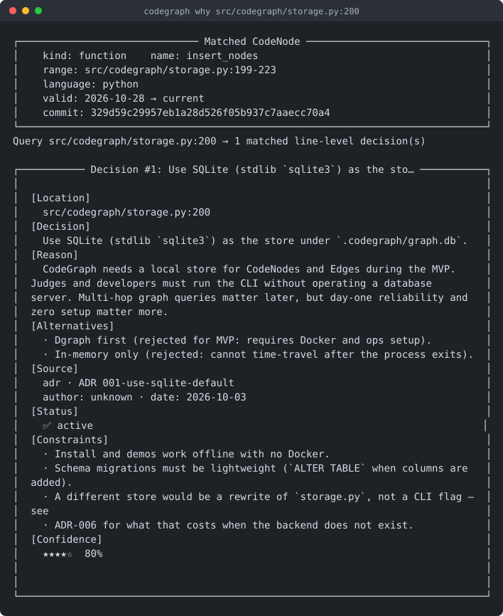
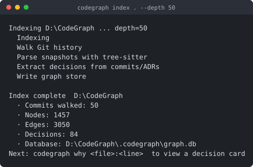
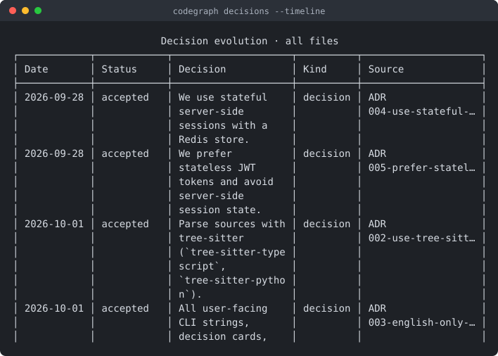
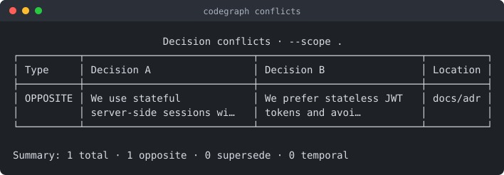

# CodeGraph

<p align="right">
  <a href="README.md">English</a> · <b>简体中文</b>
</p>

[](https://pypi.org/project/codegraphx/)


```bash
pip install codegraphx
```

把代码结构、git 历史和设计决策变成一张可查询的图 —— 问「这行为什么在这儿？」，拿到一张决策卡，而不只是一行 blame。

**为什么不直接问 AI？** 因为 AI 读不到两年前关掉的那个 issue，也因为一条 commit 标题不是答案。CodeGraph 只在记录里写明了**理由**或**被否决的备选方案**时才给出决策卡，其余一律作为历史保留，需要时再显式索取。在 Express.js 上这意味着 **242 条记录里的 22 条决策**，而不是 174 条大多是版本升级的「决策」。

**Status:** alpha · 9 个命令行命令 · 7 种语言 · SQLite 存储 · 310 个测试

> **关于 Devpost 上的数字。** 参赛作品在测第六、第七个项目时发现了两个 bug，
> 但页面在截止时冻结了。一个是全大写 C 宏被解析成了函数（`fmt` 报了 41.6 万条边，
> 实际 10.4 万），另一个是边表按调用点存了一行而不是按关系存（6–12% 的行是重复的）。
> 本仓库每张表都是修正后的数字，Devpost 页面是修正前的。
> [docs/devpost_edit_kit.md](docs/devpost_edit_kit.md) 保留了发布时的原文，
> 作为评委当时看到什么的记录。

完整架构见 [docs/architecture.md](docs/architecture.md)。

- GitHub：https://github.com/fourwich/codegraph
- 在线演示：https://fourwich.github.io/codegraph

### 长什么样

在本仓库某一行上跑 `codegraph why` —— 卡片就是决定这一行的那个 ADR，从这一行本身抵达：



`codegraph index` 建图；下面的计数是本仓库的真实输出：



`codegraph decisions --timeline` 按从旧到新列出决策，`codegraph conflicts` 报告它能给出理由的矛盾：

<p>
  
  
</p>

这些不是示意图：`scripts/render_terminal_svg.py` 渲染的是真实运行的输出，所以截图不会和工具脱节。

- 真实项目上的表现与合成性能数据见 [benchmarks](docs/benchmarks.md)
- 支持 JavaScript 后的真实效果见 [Express.js 案例](docs/case-study.md)
- `decision` 和 `event` 两类记录如何区分、精确率数字如何复现见 [决策抽取](docs/extraction-recall.md)

### 五分钟看完

```bash
pip install codegraphx      # 命令行工具名是 codegraph
codegraph index .           # 为当前仓库建图
codegraph why src/codegraph/storage.py:200    # 一张决策卡，端到端
codegraph graph --at 2026-09-28 --scope src   # 同一个仓库在过去的样子
```

想改代码？`pip install -e ".[dev]"` 然后 `pytest -q`（310 个测试，不需要联网）。

然后：[架构](docs/architecture.md) ·
[哪些测了、哪些仍是局限](docs/extraction-recall.md) ·
[给编辑器的 JSON 契约](docs/json-contract.md) ·
[五分钟讲稿](docs/pitch_5min.md)。

## 状态

用 `pytest -q` 和 `codegraph --help` 验证过（310 个测试通过，覆盖率 80% 以上）。

本 README 和 `docs/` 里每一个测试数都由 `scripts/check_materials.py` 对着 `pytest --collect-only` 核对，该脚本跑在 CI 里 —— 数字过期会让构建失败，而不是发出去。

- [x] 产品站点（HTML / CSS / JS）
- [x] 9 个命令行命令（`index` / `why` / `graph` / `decisions` / `conflicts` / `export` / `serve` / `diff` / `install-skills`）
- [x] tree-sitter 解析（7 种语言）
- [x] SQLite 存储
- [x] 真实遍历 git 历史
- [x] 从 commit、ADR、CHANGELOG 抽取决策 —— 带 `decision` / `event` 分层
- [x] 真实的时间旅行查询（`graph --at`）
- [x] 310 个测试通过
- [x] 本地网页可视化（`codegraph serve`）
- [x] VSCode 扩展 + `why --json`（已打包 vsix，可安装）
- [x] 可选的 Ollama 钩子（`--use-llm`）

## 语言支持

| 语言 | 扩展名 | 解析器 |
|---|---|---|
| TypeScript | `.ts` `.tsx` | `treesitter_ts.py` |
| JavaScript | `.js` `.mjs` `.cjs` | `treesitter_js.py` |
| Python | `.py` | `treesitter_py.py` |
| Java | `.java` | `treesitter_java.py` |
| Go | `.go` | `treesitter_go.py` |
| Rust | `.rs` | `treesitter_rust.py` |
| C++ | `.cpp` `.cc` `.cxx` `.hpp` `.hh` `.hxx` `.h` | `treesitter_cpp.py` |

## 快速开始

```bash
pip install codegraphx      # 或者：uv pip install codegraphx

cd /path/to/any/repo
codegraph index .           # 解析代码，遍历 git 历史
codegraph why src/main.py:42
```

需要 Python 3.10+。别的都不需要：不用 Docker、不用数据库服务、不用 API key。第一次 `index` 每百来条提交要几秒钟；数据都存在被索引仓库里的 `.codegraph/graph.db`。

基础安装拉 26 个包。两个功能做成可选，因为多数人用不到：

```bash
pip install "codegraphx[serve]"   # codegraph serve —— 网页可视化（+14 MB）
pip install "codegraphx[llm]"     # index --use-llm 与翻译（+4 MB，需要 Ollama）
```

两者缺了都只是给出提示，不会抛 ImportError：`codegraph why` 和 `codegraph index` 在基础安装上就能用。

网络慢的话加镜像：

```bash
pip install codegraphx -i https://pypi.tuna.tsinghua.edu.cn/simple
```

从 clone 开始：

```bash
git clone https://github.com/fourwich/codegraph
cd codegraph
pip install -e ".[dev]"     # 或者：uv pip install -e ".[dev]"
pytest -q
```

## 命令（9 个）

```bash
codegraph --help
codegraph index . [--depth N] [--use-llm] [--json] [--full]
codegraph why docs/adr/001-use-sqlite-default.md:1 [--json] [--include-events]
codegraph why insert_nodes                        # 不知道行号时按符号名查
codegraph graph --at 2026-09-23 --scope src
codegraph decisions --timeline [--file PATH] [--include-events]
codegraph diff 2026-09-23 2026-09-24 --scope src
codegraph conflicts --scope src   # opposite / supersede / temporal
codegraph export --for-ai --scope src
codegraph serve --port 8080
codegraph install-skills [--target dsh|claude|cursor|agents|published] [--list] [--force]
```

### 让你的 AI 助手会用

`why` 只有在 agent 记得去问的时候才有用。一条命令装一个 skill，告诉它什么时候该问：

```bash
codegraph install-skills
```

```
Detected: dsh, claude, agents
  wrote dsh:    ~/.dsh/skills/codegraph-why/SKILL.md
  wrote claude: ~/.claude/skills/codegraph-why/SKILL.md
  wrote agents: ~/.agents/skills/codegraph-why/SKILL.md
```

skill 提交在 [skills/codegraph-why](skills/codegraph-why)，这是 `npx skills` 和各市场扫描的路径。如果不想为了读一个 Markdown 文件装 Python 包：

```bash
npx skills add fourwich/codegraph
```

skill 就是一个带 YAML frontmatter 的 Markdown 文件 —— 每个读 skills 目录的助手都认这个格式，所以不需要为每家单独做插件。它写清了三件事：什么时候该用 `why`、每个 `binding` 级别是什么意思，以及让这个工具保持诚实的那条规矩：**查不到记录是一个答案，而不是编一个听起来合理的理由的邀请**。`--list` 只显示目录不写文件。

各目录及其约定：

| 目标 | 路径 | 谁读 |
|---|---|---|
| `dsh` | `~/.dsh/skills` | DeepSeek Harness（用户级） |
| `project` | `.dsh/skills` | DeepSeek Harness（项目级，可提交） |
| `claude` | `~/.claude/skills` | Claude Code |
| `cursor` | `.cursor/skills` | Cursor（仅项目级；它也读 `.agents/skills`） |
| `agents` | `~/.agents/skills` | Codex，以及 Cursor 的共享树 |
| `published` | `skills/` | `npx skills add` 和各 skill 市场 |

### 中文输出

卡片标签、表头、状态词、帮助文本和错误消息都翻译了。有两样是**故意不翻**的：命令名与参数名，以及 `binding` 的取值（`line`、`file`、`commit`、`dir`、`none`）—— 脚本和编辑器要读它们，所以在任何语言下都保持稳定。

```bash
CODEGRAPH_LANG=zh codegraph why src/app.py:42

查询 src/app.py:42 → 1 条行级决策

  ┌──────────── 决策 #1: Use SQLite as the store ────────────┐
  │  [位置]  src/app.py:42                                    │
  │  [决策]  Use SQLite (stdlib `sqlite3`) as the store.      │
  │  [理由]  Judges must run the CLI without a database.      │
  │  [状态]  ✅ 生效中                                         │
  └───────────────────────────────────────────────────────────┘
```

不设这个变量时，由 `LANG`/`LC_ALL` 决定；再不行看控制台编码：`cp936` 控制台得到中文，UTF-8 保持英文，好让共享的日志谁都读得懂。`CODEGRAPH_LANG=en` 强制英文。

`why` 回答的是某个代码位置的事：只绑定到文件级的决策会明说，完全没有决策的位置也会明说，而不是猜测。加 `--include-events` 可以看某一行背后的提交历史。符号名可以直接代替 `path:line`；在仓库外按符号查询时用 `--root` 指定仓库。

没有自己 commit 的决策（ADR、CHANGELOG 条目）会绑定到它们声明的代码上，所以一条设计规则可以从它管辖的那一行抵达：

```markdown
# ADR-001: SQLite as the default graph store

<!-- governs: src/codegraph/storage.py -->
```

## 技术栈

| 层 | 选择 |
|---|---|
| 命令行 | Python · Typer · Rich |
| 数据模型 | pydantic |
| 解析 | tree-sitter（+ 各语言语法） |
| Git | GitPython |
| 存储 | SQLite（本地 `.codegraph/graph.db`） |
| 网页 | FastAPI · Uvicorn · Cytoscape.js |
| LLM（可选） | 通过 httpx 调 Ollama |
| 编辑器 | VSCode 扩展（TypeScript，`vscode-extension/`） |
| 测试 | pytest |

## 测试

```bash
pytest -q
# 带覆盖率
pytest --cov=src/codegraph
```

## 存储

所有东西都在一个本地 SQLite 数据库里：`.codegraph/graph.db`，由 `codegraph index` 创建。没有服务端、没有 Docker、不依赖网络。

原生图数据库后端（Dgraph 之类）做过原型，**已移除**：那是 503 行没测试过的客户端代码，藏在 `--backend dgraph` 后面，没有任何需要它的多跳查询，而且它有两条路径分别返回样本数据或静默忽略该参数。等真有需要多跳的查询时它再回来 —— 见 [docs/adr/006-drop-dgraph-backend.md](docs/adr/006-drop-dgraph-backend.md)。

## 项目结构

```text
src/codegraph/
  cli.py          # Typer 入口
  models.py       # CodeNode / Edge / Decision
  storage.py      # SQLite 图存储
  parser/         # tree-sitter 解析器（7 种语言）
  commands/       # index / why / graph / decisions / conflicts / export / serve / diff
tests/
docs/             # 案例、基准、ADR、演示脚本、参赛材料
index.html        # 产品站点
```

## 文档

- 架构：`docs/architecture.md`
- 决策抽取与精确率：`docs/extraction-recall.md`
- Express.js 案例：`docs/case-study.md`
- 架构决策记录：`docs/adr/`
- 60 秒演示旁白：`docs/demo_voiceover.md`
- 参赛材料：`docs/competition_submission.md`
- 贡献指南：`CONTRIBUTING.md`

## 开发说明

用 AI 编程助手做 API 查找、调试和文档。架构、设计决策和最终代码审查是我自己的。

## 许可证

MIT
